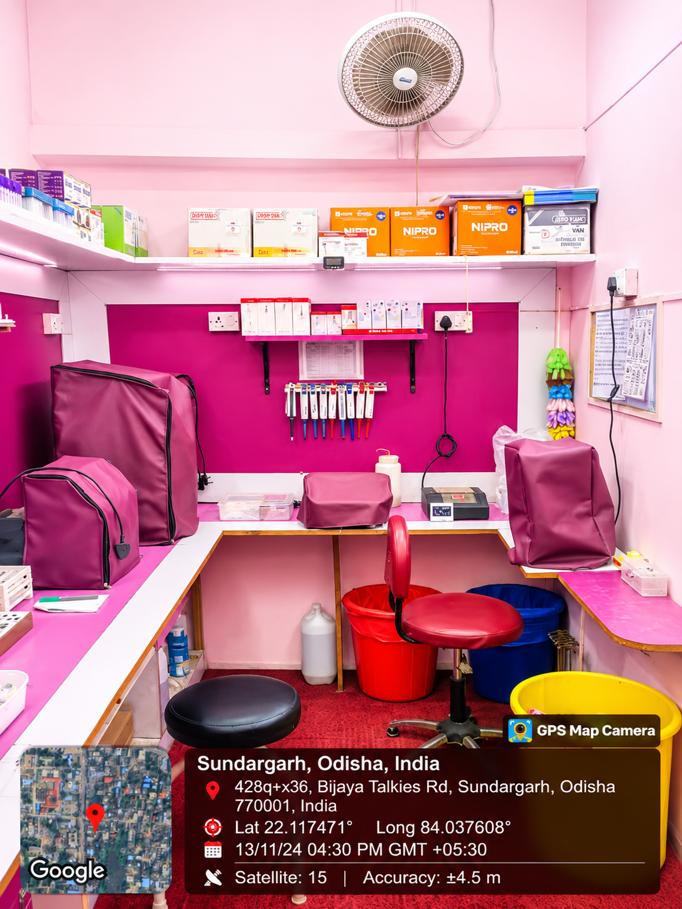

# Patel Diagnostic Center

A React website for Patel Diagnostic Center. The site presents diagnostic services, health-checkup packages, clinic information, patient reviews, and inquiry/contact options. The repository also contains login, registration, password-reset, and protected admin pages.



> **Screenshot placeholders:** Replace the paths below with actual screenshots before publishing, or upload screenshots to GitHub and use the URLs GitHub provides.

<!-- Replace with a screenshot of the homepage. -->


<!-- Replace with a screenshot of the services and packages sections. -->


## Features

- Landing page with clinic introduction, laboratory gallery, and accreditation information.
- Diagnostic service information for pathology, radiology, cardiology, preventive checkups, diabetes and metabolic testing, and home sample collection.
- Health-checkup package cards with inquiry actions.
- Contact and inquiry forms, WhatsApp contact, and patient-review content.
- Login, registration, password reset, and a protected admin route.
- Responsive layouts and animated section reveals.

Service, package, price, contact, and review content is maintained in the frontend. Confirm that it is current and approved before using the site as an official source of clinic information.

## Technology

- React 18
- Vite
- React Router
- Tailwind CSS
- Framer Motion
- TanStack Query
- Lucide icons

## Getting started

### Requirements

- Node.js and npm
- Access to the compatible Base44 authentication/runtime configuration for authentication-backed pages
- A backend API for API-backed features, if those features are enabled

### Install and run

```bash
npm ci
npm run dev
```

Vite prints the local development URL in the terminal (typically `http://localhost:5173`). `npm run dev` starts the frontend; it does not start or provision a backend.

### Environment variables

The frontend API client reads `VITE_API_URL`. If it is not set, it uses `http://localhost:5000/api`.

Create a local `.env.local` file when you need to override it:

```dotenv
VITE_API_URL=http://localhost:5000/api
```

The app also reads `VITE_APP_ID` for its app identifier and falls back to `local-app`. Authentication-backed routes use the Base44 runtime, so configure the runtime and authentication service for your environment as well. Keep local environment files and credentials out of Git.

## Available scripts

| Command | Description |
| --- | --- |
| `npm run dev` | Start the Vite development server |
| `npm run build` | Create the production build in `dist/` |
| `npm run preview` | Preview the production build locally |
| `npm run lint` | Run ESLint |
| `npm run review-check` | Run ESLint and TypeScript checks |

Build the site with:

```bash
npm run build
```

Deploy the generated `dist/` directory to a static hosting provider. Configure the required API and Base44 services in the hosting environment, and enable SPA fallback routing so paths such as `/login` and `/admin` are served by the app entry point.

## Routes

| Path | Page |
| --- | --- |
| `/` | Diagnostic center homepage |
| `/login` | Login |
| `/register` | Registration |
| `/forgot-password` | Password recovery |
| `/reset-password` | Password reset |
| `/admin` | Protected admin page |

Unknown routes display the not-found page.

## Project layout

```text
src/
  components/site/   Homepage sections and shared site components
  components/ui/     Reusable UI components
  api/               Frontend API client
  lib/               Authentication context, routing helpers, and utilities
  pages/             Homepage, account, and admin pages
public/
  images/            Clinic, laboratory, accreditation, and QR images
```

The homepage sections are assembled in `src/pages/Home.jsx`. Service and package display data is in `src/components/site/siteData.js`.

## Image placeholders

The two `docs/images/...` references near the top are intentional screenshot placeholders; no screenshots are included at those paths yet. Add the screenshots there or replace the Markdown image URLs with GitHub-uploaded image URLs.

## License

No license is specified in this repository. Contact the repository owner before reusing or redistributing the project.